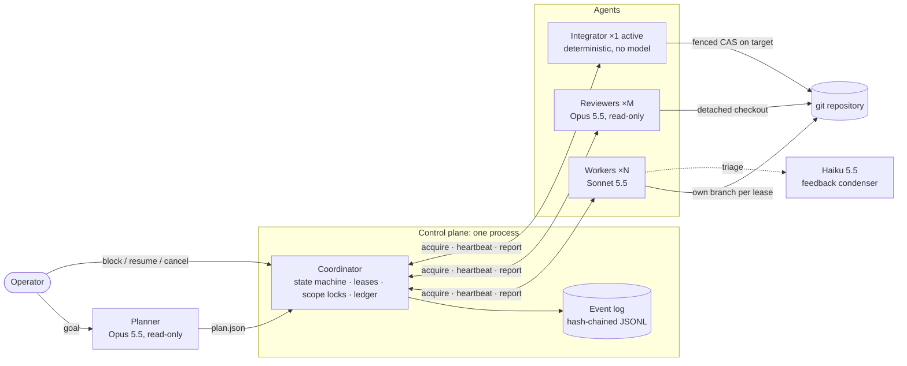
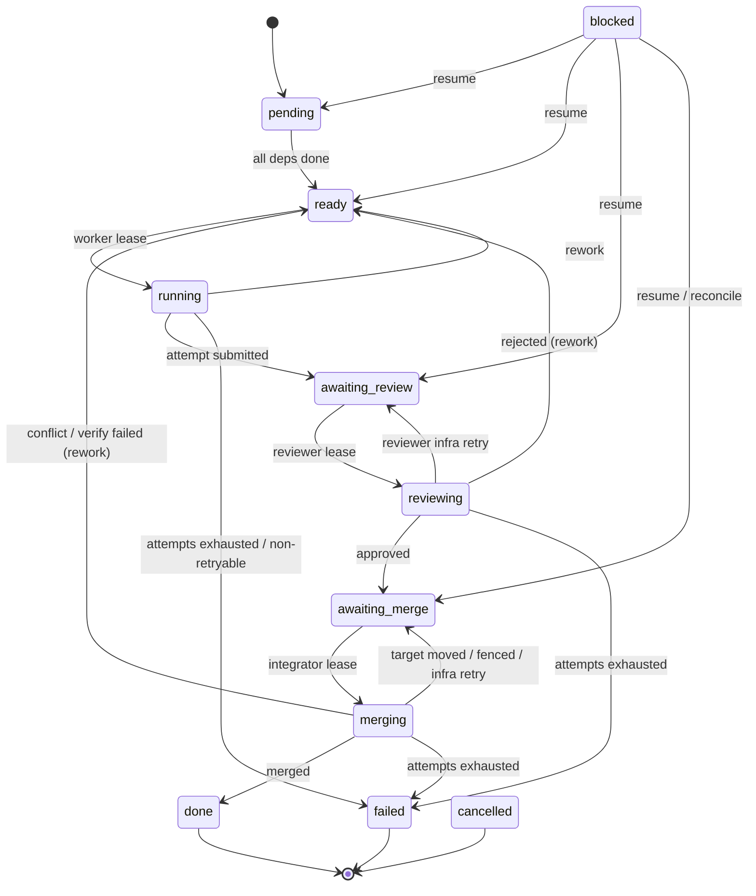

# FLEET-A architecture

FLEET-A runs many autonomous coding agents against one git repository at once and lands their work on a target branch without corrupting it, double-applying it, or overspending. This document is the specification. The code in `fleet_a/` implements it, and `tests/` checks it, including a fault-injecting simulator and mutation tests that prove each safety mechanism is necessary.

Section numbers are stable; code comments and tests refer to them.

## 1. Goals and non-goals

**Goals**

1. Turn a goal into a dependency graph of tasks and land each task on the target branch as one reviewed, verified commit.
2. Run independent tasks in parallel; never run two tasks that may edit the same path at the same time.
3. Stay correct under any agent failure: crash, hang, timeout, late reply, wrong output, budget overrun.
4. Never spend a dollar that was not reserved first; stop cleanly when money runs out.
5. Make every decision auditable after the fact from a tamper-evident log.
6. Keep humans in control: any task can be blocked, resumed, or cancelled at any time without breaking invariants.

**Non-goals (v1)**

- Several repositories per run, or pushing to a remote. The integrator lands on a local branch; publishing is a separate step (section 15).
- Recovering a crashed coordinator mid-run. The event log is an audit trail, not a recovery journal (section 15).
- Finding semantic conflicts between tasks with disjoint scopes beyond what the verification command catches.
- Sandboxing the host. FLEET-A restricts what agents may do through Claude Code's permission system; the container or VM it runs in must restrict the rest (section 12).

## 2. Topology


The same system as a component graph:



- **The coordinator is the only component that changes task state.** Agents ask it for work (`acquire`), prove they still own it (`heartbeat`), and report once (`submit_*` or `fail`). It is a single process with one re-entrant lock; every public call is atomic and appends its state changes to the event log before returning.
- **The integrator is the only component that writes the target branch**, and it runs no model.
- **Agents write only their own branches.** A worker's branch is named after its lease, so no two leases can share one.

Code: `coordinator.py`, `runner.py`, `mergequeue.py`, `workspaces.py`, `executors.py`.

## 3. Roles

| Role | Runs | Model (default) | Effort | Tools | Writes | Per-phase money |
|---|---|---|---|---|---|---|
| Planner | once, before the run | `claude-opus-5-5` | high | Read, Glob, Grep, `git log`, `git ls-files` | nothing | `planner_budget_usd` ($5.00) |
| Worker | per attempt | `claude-sonnet-5-5` (fallback `claude-sonnet-5`) | medium | Read, Edit, Write, Glob, Grep, Bash; denied: web, `git push/commit/checkout/switch/reset/rebase/worktree/update-ref` | its lease's worktree | task's `attempt_budget_usd` ($2.00) |
| Triage | inside a worker attempt, only when feedback exceeds `triage_threshold_chars` | `claude-haiku-5-5` | low | none | nothing | min(`triage_budget_usd`, attempt/10), taken out of the attempt's reservation |
| Reviewer | per submitted attempt | `claude-opus-5-5` (fallback `claude-opus-5`) | high | Read, Glob, Grep, `git diff/log/show`, `pytest`; denied: Edit, Write, web, push | nothing | `review_budget_usd` ($1.50) |
| Integrator | per approved attempt | none | — | git plumbing | the target branch, under a fence | $0 |

Every model session is headless Claude Code (`claude -p`) launched with: `--output-format json`, `--model`, `--effort`, `--max-budget-usd` equal to the phase's reservation, `--permission-mode` (`acceptEdits` for workers, `manual` otherwise), `--permission-prompts none` so anything not pre-approved is denied rather than asked, `--allowedTools`/`--disallowedTools`, `--json-schema` for a typed result, `--no-session-persistence`, `--setting-sources project`, `--strict-mcp-config` (no MCP servers), and `--exclude-dynamic-system-prompt-sections` so all sessions of a role share one cacheable system prompt. `bypassPermissions` is rejected by config validation. Code: `executors.py`, `config.py`.

Why these models: planning and review are where a wrong call is expensive (a bad task graph, or a bad change approved), so they get the strongest model at high effort. Implementation is the bulk of the spend, and Sonnet 5.5 at medium effort is the recommended start for agentic coding; reviews catch what it misses. Triage is summarization, where Haiku is enough. All four are overridable per role in the config.

## 4. Data model

### 4.1 Plan and task

A **plan** is `{id, goal, tasks[]}`. A **task** (`TaskSpec`, `model.py`):

| Field | Type | Rule |
|---|---|---|
| `id` | string | `^[A-Za-z0-9][A-Za-z0-9._-]{0,63}$`, no `..`, not ending in `.` or `.lock`, unique (safe in branch and ref names) |
| `title`, `description` | string | non-empty |
| `acceptance` | string[] | concrete, testable criteria shown to worker and reviewer |
| `deps` | id[] | must exist; no self-edges, duplicates or cycles (cycle reported as a path) |
| `write_scope` | path[] | non-empty; grammar in 4.2 |
| `capabilities` | string[] | an agent must have all of them to take the task; `validate` and `run` reject a plan with a task that no worker pool and no reviewer pool can take, and the planner may use only tags that some worker pool and some reviewer pool carry |
| `priority` | int | higher first (section 7) |
| `max_attempts` | int 1..20 | default 3 |
| `attempt_budget_usd` | decimal string | reserved per worker attempt, default "2.00" |
| `budget_usd` | decimal string | task cap; default `max_attempts × (attempt_budget + review_budget)` |

Unknown keys are rejected everywhere (plan, task, config) so a typo can never silently become a default.

### 4.2 Write scopes

A write scope is the set of paths a task may create, modify or delete. Entries are repository-relative POSIX paths:

- `"src/api/"` (trailing slash) covers every path under that directory;
- `"src/app.py"` covers exactly that file;
- `"*"` covers the whole repository.

Globs, absolute paths, `..`, backslashes and `.git` are rejected. Entries covered by a directory entry are dropped. Two entries **overlap** iff one covers the other or they name the same path with and without a trailing slash. This makes overlap decidable by string comparison, which is the point: scopes exist so that conflicts are provably impossible, not probably unlikely. Code: `scopes.py`.

### 4.3 Money

All accounting uses integer micro-dollars (`usd_to_micros`), so sums are exact. Dollar amounts in plans and config are decimal strings.

## 5. Task lifecycle



Not drawn: every non-terminal state except `merging` can go to `blocked` and to `cancelled`; `merging` reaches them only through a merge outcome or exhausted infrastructure retries (5.2, 5.3). `done`, `failed` and `cancelled` are terminal. `fsm.py` holds the complete table; any other transition raises `IllegalTransition`.

### 5.1 Transitions

| From → To | Trigger and guard |
|---|---|
| pending → ready | every dependency is `done` (checked at start, when a dependency lands, and on resume) |
| ready → running | worker `acquire`: agent has the task's capabilities, the scope is free, the attempt budget is reserved, `attempts < max_attempts`; `attempts += 1`, scope locked |
| ready → blocked | the task account cannot fund another attempt (resume to `ready`); or operator |
| running → awaiting_review | `submit_work` with the live token, non-empty change, every changed path inside the scope |
| running → ready / failed | **rework**: retryable failure, lease expiry, scope violation, empty attempt; `failed` once `attempts == max_attempts` |
| running → failed | non-retryable worker failure |
| running → blocked | worker reports `status: "blocked"` (escalation), or operator |
| awaiting_review → reviewing | reviewer `acquire`: capabilities match, **reviewer ≠ author**, review budget reserved |
| awaiting_review → blocked | the task account cannot fund the review (scope stays held); or operator |
| reviewing → awaiting_merge | verdict approves and has no `blocker` or `major` finding |
| reviewing → ready / failed | rejected: rework with the findings as feedback |
| reviewing → awaiting_review | reviewer failure or lease expiry, while `infra_failures ≤ max_infra_retries` |
| reviewing → blocked | infra retries exhausted, non-retryable reviewer failure, or operator |
| awaiting_merge → merging | integrator `acquire`, FIFO by approval time; at most one task merging |
| merging → done | outcome `merged` (landed now, or found already landed) |
| merging → awaiting_merge | `target_moved`, `fenced`, integrator failure or lease expiry, while within `max_infra_retries` |
| merging → ready / failed | `conflict` or `verify_failed`: rework with the output as feedback |
| merging → blocked | `scope_violation` (defence in depth: resume to `ready`), or infra retries exhausted |
| merging → cancelled | a deferred cancel, applied when the outcome is anything but `merged` |
| blocked → (resume target) | operator `resume`; or a cancel that must first reconcile an unresolved merge (→ `awaiting_merge`) |
| any open → cancelled | operator cancel, or an upstream task became `failed`/`cancelled` (cascade) |

### 5.2 Rework, attempts and infrastructure retries

**Attempts** measure work quality. One is consumed per worker lease. Anything wrong with the *work* (failed tests, rejected review, merge conflict, verify failure, scope violation, empty change, worker crash) sends the task back to `ready` with the reason appended to its feedback, until `max_attempts` is reached and it fails.

**Infrastructure retries** measure everything else (reviewer crash, integrator crash, target moved). They do not consume attempts. `infra_failures` resets when an attempt is submitted and when it is approved. Past `max_infra_retries` the task blocks for a human instead of looping.

**Phase bound.** Between operator actions, a task runs at most `max_attempts × (1 + 2·(max_infra_retries + 1))` phases before it is terminal or blocked. With defaults, 3 × 9 = 27.

### 5.3 Cancel and block

`cancel` is immediate except while a merge may have landed: the task is `merging`, or an earlier integrator lost its lease mid-merge (`merge_unresolved`). Then the cancel is **deferred**: it is recorded, and the next merge outcome resolves it. If the change landed, the task ends `done` (event `cancel_superseded`), because a landed commit cannot be un-landed by a state change. Otherwise it ends `cancelled`. A blocked task with an unresolved merge is moved to `awaiting_merge` so the integrator can reconcile first. Without this rule a cancelled task could have its change on the target; the mutation test `test_detects_missing_deferred_cancel` shows the simulator catching exactly that.

`block` parks a task for a human and records where `resume` returns it: `pending`/`ready` work resumes to `ready` (or `pending` if a dependency is not done); review and merge resume to their queues with the scope still held. `block` is refused while a merge is unresolved. `resume` can add attempts and budget.

## 6. Leases and fencing

- A **lease** gives one agent exclusive authority over one phase of one task until `expires_at`. TTLs: worker 900 s, reviewer 600 s, integrator 600 s.
- The runner **heartbeats every TTL/3**; each heartbeat extends the lease to a full TTL from now, so a lease survives one missed heartbeat and expires after a full TTL of silence.
- Every grant takes the next value of one counter: the **fencing token**. Tokens strictly increase across the run.
- Every report carries its token. A token that is not the task's current, unexpired lease raises `StaleLease`, changes nothing, and is logged as `stale_rejected`.
- **Expiry** is checked at the start of every coordinator call. On expiry, the phase's reservation is charged in full (the agent may have spent all of it) and the task moves on: a worker phase is reworked, a reviewer phase is retried, an integrator phase is retried and marked `merge_unresolved`.
- If a heartbeat is refused, the runner kills the session (process group SIGTERM, then SIGKILL) and reports nothing.
- An agent holds at most one lease.

Workers and reviewers cannot cause damage after losing a lease: a worker's branch is unique to its lease and a reviewer writes nothing. The integrator can, because it writes the target branch, so it is also fenced **at the storage layer** (section 9).

## 7. Scheduling

`acquire(agent)` runs under the lock:

```
expire overdue leases
if the agent already holds a lease: error
if active phases for the agent's role >= max_concurrent[role]: return none
for task in queue(role) ordered by rank(role):
    skip unless eligible(task, agent)              # capabilities ⊆ agent's; reviewer ≠ author
    skip if role is worker and scope overlaps a held scope
    reserve the phase budget                       # may fail the task (attempts) or block it (task budget)
    skip if the reservation failed
    worker: lock the scope; attempts += 1
    grant a lease with the next token; move the task to the active state; return the assignment
return none
```

**Ranking** (`scheduler.py`) is a total order:

| Role | Sort key (ascending) |
|---|---|
| Worker | −(priority + ⌊wait / aging_interval⌋), −critical-path depth, ready time, id |
| Reviewer | −(priority + ⌊wait / aging_interval⌋), queued time, id |
| Integrator | approval time, id (FIFO) |

The aging term adds one priority point per `aging_interval_s` (600 s) of waiting, so low-priority work cannot starve. Critical-path depth (the longest chain of dependents) breaks ties toward the work that unblocks the most.

**Concurrency limits**: worker 8, reviewer 2, integrator exactly 1 (enforced by config validation).

**Scope locks** are acquired all-or-nothing at dispatch and held through review and merge, so an approved change cannot be invalidated by a concurrent overlapping edit before it lands. They are released when the task returns to `ready`, finishes, or blocks to `pending`/`ready`. Because a task never waits while holding a lock, the hold-and-wait condition cannot arise and **scope locking cannot deadlock**.

**Stalls.** `stall_reason(agents)` returns why no progress is possible, or `None`. A stall is declared only when no lease is live and no queued task is dispatchable to any agent; with no live lease, only an operator call can change state, so a stall is stable. Reasons: tasks blocked awaiting an operator, no eligible agent for a task, run or fleet budget exhausted.

## 8. Workspaces and attempts

- Each worker lease gets a new worktree at `<worktrees>/<run>/<task>-a<attempt>-t<token>` on branch `fleet/<run>/<task>/a<attempt>-t<token>`, created from the current tip of the target branch. The run id is part of both because fencing tokens restart at 1 in every run: without it, a second run of the same plan collides with branches an earlier run left behind. Reviewer and integrator checkouts live under `<worktrees>/<run>/` too.
- The worker session edits files only. When it returns `status: "done"`, the runner squashes everything (including any commits the agent made) into **one commit on top of the base**, with trailers:

  ```
  fleet(<task>): <title>

  <worker summary, with any line shaped like a Fleet-* trailer removed>

  Fleet-Run: <run id>
  Fleet-Task: <task>
  Fleet-Attempt: <n>
  Fleet-Agent: <agent>
  Fleet-Token: <token>
  ```

- The **run id** is `<plan id>-<8 random hex digits>`, fixed when the coordinator starts. Fencing tokens restart at 1 in every coordinator, so everything a run leaves in git (fence refs, trailers) carries the run id and no two runs can collide.
- The changed-file list is computed with `git diff --name-only --no-renames base head` (a rename lists both paths, so moving a file out of scope is caught).
- Reviewers get a detached worktree at the attempt's commit and are told the base and head commits.
- Worktrees are removed when the phase ends; attempt branches are kept as the audit trail.

## 9. Integration

```mermaid
sequenceDiagram
    participant I as Integrator (token t)
    participant F as refs/fleet/fence/<run>/<task>
    participant T as refs/heads/<target>
    I->>F: claim: CAS to blob("t") unless held by a token > t
    I->>T: reconcile: commit whose trailer block is this run, task and attempt already on target?
    alt already landed
        I-->>I: outcome merged (no writes)
    else not landed
        I->>I: rebase the attempt onto T's tip (scratch worktree)
        I->>I: re-check write scope on the rebased change
        I->>I: run verify_command on the rebased tree
        I->>T: update-ref --stdin { verify F = blob("t"); update T new old }
        Note over I,T: one atomic transaction: lands only if this lease still owns the fence and T has not moved
    end
```

| Outcome | Meaning | Task goes to |
|---|---|---|
| `merged` | landed now, or found already landed | `done` |
| `conflict` | rebase failed, or the rebase left no change | rework |
| `verify_failed` | verification command failed or timed out | rework, with its output tail as feedback |
| `scope_violation` | the rebased change touches a path outside the scope | `blocked` (should not happen: also checked at submit) |
| `target_moved` | the CAS lost to another writer of the target | `awaiting_merge` (infra retry) |
| `fenced` | a newer lease owns the fence | `awaiting_merge`; a stale integrator's report is rejected anyway |

**Why the fence.** Lease expiry alone cannot stop a slow integrator that already passed its last check: it could land an attempt after the coordinator moved the task on, for example after a newer integrator reported a conflict and the task went back to rework. The fence ref puts the fencing token where the write happens. The claim only moves the fence to a *higher* token, and the landing transaction verifies the fence still holds *its* claim, so after a newer lease claims it no older integrator can land anything for that task. `test_newer_lease_fences_out_an_in_flight_merge` exercises this against real git; `test_detects_missing_merge_fence` shows the simulator catching a fence-less integrator landing a task that then failed.

**Why reconciliation.** If an integrator lands and then loses its lease before reporting, the next integrator finds the trailer commit on the target and reports `merged` without touching anything. Landing is therefore idempotent, and the coordinator's view converges on what git says.

Reconciliation reads only git's parsed trailer block (the message's final paragraph, via `%(trailers:key=…,valueonly)`) and requires exactly one `Fleet-Run`, `Fleet-Task` and `Fleet-Attempt` value, each equal to what it is looking for. Model-written text in the message body can therefore never make a task look landed, and the worker's summary is also stripped of trailer-shaped lines before it is committed. Fence refs are kept after the run as an audit record; remove them with `git for-each-ref --format='delete %(refname)' refs/fleet/fence/<run>/ | git update-ref --stdin` once nothing from that run is running.

The verification command (default `python3 -m pytest -q`, timeout 1200 s) runs on the *rebased* tree: what is verified is exactly what lands.

## 10. Budgets

```
fleet  (fleet_budget_usd, $500)
└── run:<plan>  (run_budget_usd, $100)
    └── task:<id>  (budget_usd, default max_attempts × (attempt_budget + review_budget))
```

- **Admission**: a phase starts only after `reserve(task, amount)` succeeds on *every* account up the chain. Worker amount = `attempt_budget`; reviewer = `review_budget`; integrator = 0.
- **Hard cap per session**: the reservation is passed to Claude Code as `--max-budget-usd`.
- **Settlement**: on report the reservation is committed at the reported `total_cost_usd`. If the cost is unknown (lease expiry, cancel, executor timeout), the full reservation is charged.
- **Overrun**: a cost above its reservation is recorded as `overrun` on every account in the chain and freezes any account it pushes over its limit; a frozen account admits nothing until an operator raises its limit.
- **Exhaustion**: a task account that cannot fund the next phase blocks the task (`resume --extra-budget`). A run or fleet account that cannot fund it leaves the task queued; when nothing else can run, the run stalls with reason `run/fleet budget cannot fund $X`.
- **Invariant**: `spent + reserved ≤ limit + overrun` for every account, always.
- **Worst case** for a plan is the sum of task budgets; `fleet_a validate` prints it and whether it fits the run budget.

**Cost levers** (in order of how much they save without hurting quality):

1. Prompt caching: system prompts are constants per role (`prompts.py`) and per-machine prompt sections are excluded, so every session of a role reuses one cached prefix.
2. Effort per role: medium for workers, high only where a wrong answer is costly.
3. Triage: long feedback (test logs, review findings) is condensed by Haiku before it reaches the worker's prompt.
4. Rework uses attempts, not open-ended retries; reviews reject early.

## 11. Failure model

| Failure | Detected by | Response |
|---|---|---|
| Worker process crashes or hangs | missed heartbeats → lease expiry | charge reservation in full; rework (new attempt, new branch) |
| Worker returns after expiry | token check | `StaleLease`; nothing changes; `stale_rejected` logged |
| Worker session times out | executor timeout (worker 3600 s) | kill process group; charge in full; retryable failure → rework |
| Model API overloaded or unavailable | Claude Code | `--fallback-model`; if the session still fails, retryable failure |
| Worker cannot finish within scope or needs a decision | structured result `status: "blocked"` | task `blocked`, reason recorded, dependents wait |
| Worker edits outside its scope | changed-file check at submit | rework with the violating paths as feedback |
| Worker produces no change | empty squash | rework |
| Reviewer crashes, times out or errors | expiry or failure report | retry review (no attempt used); block after `max_infra_retries` |
| Review rejects | verdict | rework with findings |
| Integrator crashes mid-merge | lease expiry | `merge_unresolved`; next integrator claims the fence, then reconciles |
| Stale integrator tries to land | fence verify in the landing transaction | nothing lands (`fenced`) |
| Someone else moves the target | CAS in the landing transaction | `target_moved`; re-queued |
| Rebase conflict | `git rebase` exit status | rework with conflict output |
| Tests fail on the rebased tree | verify exit status or timeout | rework with output tail |
| Cost above reservation | settlement | overrun recorded; account frozen if over limit |
| Budget exhausted | reservation failure | task blocked, or run stalls with a reason |
| Operator cancels during a merge | merge in flight | cancel deferred until the outcome (5.3) |
| Upstream task fails or is cancelled | transition | all descendants cancelled in the same atomic step |
| Plan has a cycle or unknown dependency | validation | rejected before the run, cycle printed as a path |
| Coordinator process dies | process exit | run ends; see section 15 |

## 12. Security

- **No model writes the target branch.** Only the deterministic integrator does, after review and verification.
- **Least privilege per role.** Reviewers and the planner cannot edit files; nobody can push; workers cannot rewrite git history or switch branches; no web access by default; no MCP servers; no user-level settings or hooks (`--setting-sources project`). Anything not explicitly allowed is denied without prompting (`--permission-prompts none`). `bypassPermissions` cannot be configured.
- **Separation of duties.** The agent that wrote an attempt can never review it.
- **Scope enforcement in two places**: at submit, and again on the rebased change before landing.
- **Isolation is per lease**: unique worktree and branch; worktrees are removed after each phase.
- **Host isolation is the deployment's job.** Workers run `Bash` in their worktree. Run the fleet in a container or VM with no credentials beyond the model API key, no network egress except the model API and package mirrors the tests need, and a disposable clone of the repository.
- **Audit**: every state change, reservation, settlement, expiry and rejected stale report is in the hash-chained event log; `fleet_a verify-log` detects any edit, deletion or reordering.

## 13. Invariants

The simulator (`sim.py`) checks safety invariants S1–S10 after every step and S11–S12 at the end of every run, across randomized plans with crashing, stalling, failing, overrunning and scope-violating agents, racing integrators, and an operator who cancels, blocks and resumes at random. `tests/test_sim.py` then disables each mechanism in turn and asserts the simulator reports a violation.

| # | Invariant | Enforced by | Mutation test |
|---|---|---|---|
| S1 | A task is in an active state iff it has exactly one lease, of the matching role | `_grant`, `_transition`, `_sweep` | — |
| S2 | Fencing tokens strictly increase; a report with any other token is rejected and changes nothing but the log | `LeaseTable` | `test_detects_stale_tokens_being_accepted` |
| S3 | An agent holds at most one lease | `acquire` | — |
| S4 | Held write scopes never overlap; every task from `running` to `merging` holds its scope | `ScopeLocks`, `_transition` | `test_detects_missing_scope_locks` |
| S5 | No agent reviews its own attempt | `_eligible` | — |
| S6 | At most one task is `merging` | `max_concurrent.integrator == 1` | — |
| S7 | `spent + reserved ≤ limit + overrun` on every account; a reservation is open iff the task is `running` or `reviewing` | `Ledger`, `_settle` | `test_detects_missing_budget_admission` |
| S8 | A task that is not `done` has no descendant past `pending` (other than `blocked`/`cancelled`) | `_promote` | — |
| S9 | No open task depends on a `failed` or `cancelled` task | cascade in `_transition` | `test_detects_missing_cascade` |
| S10 | No task's change lands on the target twice | fence + CAS + reconciliation | `test_detects_missing_merge_fence` |
| S11 | Every `done` task landed exactly once; no `failed` or `cancelled` task landed | S10 + deferred cancel | `test_detects_missing_deferred_cancel` |
| S12 | The log's hash chain verifies, replaying it reproduces every task's state, and no task first ran before its dependencies were `done` | `EventLog`, `project_states` | — |

**Liveness**

- **L1 Termination.** With finitely many faults and no operator, every task reaches a terminal state or the run reaches a stable stall that `stall_reason` names. Each task runs a bounded number of phases (5.2), and each phase either changes state or consumes budget.
- **L2 No starvation.** Aging raises a waiting task's effective priority without bound.
- **L3 No deadlock.** Scope locks are acquired atomically and never held while waiting (section 7).

## 14. Observability

The event log is JSONL, one event per line: `{seq, ts, kind, task, data, prev, hash}`, where `hash = sha256(canonical_json(event without hash))` and `prev` is the previous event's hash (genesis: 64 zeros).

| kind | When | Key data |
|---|---|---|
| `plan` | run start | plan id, run id, task ids in topological order, budgets, target branch |
| `transition` | every state change | from, to, reason, attempt; on lease: agent, token, expires_at, reserved_usd |
| `spend` | every settlement | reserved_usd, charged_usd, overrun_usd, estimated |
| `lease_expired` | expiry | token, agent, role |
| `stale_rejected` | a report or failure with a stale token | token, role |
| `cancel_deferred`, `cancel_superseded` | deferred cancels (5.3) | reason |

`fleet_a run` prints a JSON summary (states, spend, per-task attempts, reasons and merged commits) and exits 0 when every task is done, 2 when some failed or were cancelled, 3 on a stall or timeout. `fleet_a verify-log` checks a log's chain and replays its states.

## 15. Capacity, limits and deployment

**Throughput.** Merges are single-flight, so a run lands at most one task per merge duration *T*<sub>m</sub> (rebase + verify). With a 4-minute test suite that is about 15 tasks per hour, however many workers run. More workers help only until then:

- Workers needed ≈ λ · *T*<sub>w</sub> · *a*, where λ is the landing rate, *T*<sub>w</sub> the mean worker phase and *a* the mean attempts per landed task.
- Reviewers needed ≈ λ · *T*<sub>r</sub> · *a*.
- Parallelism is also limited by the width of the task graph and by overlapping scopes.

The cheapest way to raise the ceiling is a faster `verify_command` (for example, only the affected test packages).

**Expected cost** per landed task ≈ *a* · (worker cost + review cost) + triage; worst case is the task budget.

**Deployment.**

1. Use a dedicated clone of the repository with the target branch *not* checked out (the integrator moves the ref with `update-ref`).
2. `fleet_a plan --repo R --goal "..." --out plan.json`, then review and edit the plan: it is the contract.
3. `fleet_a validate plan.json --config fleet.json`.
4. `fleet_a run --repo R --plan plan.json --config fleet.json` inside the isolated environment from section 12.
5. Publish: push the target branch from the clone after reviewing the run summary.

**Known limits of v1.**

- The coordinator keeps state in memory. If it dies, start a new run for the remaining tasks. The new run gets a new run id, so it neither inherits the old run's fences nor reconciles against its commits. Decide which tasks landed from git, not from the old log: a merge can land in the instant between the integrator's atomic `update-ref` and the `done` transition being logged, so the log can show a landed task as still merging.
  1. Find the old run id in the run summary (`"run"`) or in the old log's `plan` event.
  2. `fleet_a landed --repo R --run <old run id>` lists every task of that run whose commit is on the target branch, read from the exact `Fleet-Run`/`Fleet-Task`/`Fleet-Attempt` trailers.
  3. Remove those tasks from the plan, and remove them from the `deps` of the remaining tasks: those dependencies are already met on the target branch, and a `deps` entry naming a task outside the plan fails validation.
- One repository and one target branch per run.
- No batching of merges, so merge time bounds throughput (above).
- Semantic conflicts between tasks with disjoint scopes are caught only by the verification command.

## 16. Decisions

| # | Decision | Alternatives rejected | Reason |
|---|---|---|---|
| D1 | A central coordinator owns all task state | agents coordinating through git refs or a shared board | one lock makes every invariant a local check; peer-to-peer protocols need consensus to give the same guarantees |
| D2 | Leases with heartbeats and fencing tokens | locks without expiry; expiry without tokens | expiry gives liveness when agents die; tokens give safety when "dead" agents come back |
| D3 | Write scopes are path prefixes and files, not globs | globs; no scopes and resolve conflicts at merge | overlap is decidable and cheap, and conflicts are prevented instead of repaired |
| D4 | The integrator is deterministic code | an agent that merges and resolves conflicts | landing must be fenced, idempotent and auditable; conflicts go back to a worker as rework with feedback |
| D5 | One squashed commit per attempt, with trailers | the agent's own commits | a single unit to review, verify, land and reconcile by trailer |
| D6 | Separate reviewer agent, stronger model, read-only | self-review; tests only | catches wrong-but-passing changes; reviewer cannot "fix" what it judges |
| D7 | Reserve before every phase, in integer micro-dollars | post-hoc cost tracking | spend can never exceed what was admitted, except for recorded overruns that freeze the account |
| D8 | Headless Claude Code per phase | a custom Messages API tool loop | Claude Code already provides the coding tools, permissions, budget caps, structured output and fallback; FLEET-A only orchestrates |
| D9 | Cancels during a merge are deferred | immediate cancel | a landed commit cannot be undone by a state change; the coordinator must never claim `cancelled` for a change that landed |
| D10 | Attempts and infrastructure retries are counted separately | one retry counter | flaky infrastructure must not burn the attempts that measure work quality, and must still stop eventually |

## 17. Configuration reference

All keys optional; unknown keys are errors. Dollar values are decimal strings.

| Key | Default | Meaning |
|---|---|---|
| `target_branch` | `main` | branch the integrator lands on (not under `fleet/`) |
| `fleet_budget_usd` / `run_budget_usd` | `500` / `100` | top of the budget tree (run ≤ fleet) |
| `review_budget_usd` | `1.50` | reserved per review (> 0) |
| `planner_budget_usd` | `5.00` | cap for `fleet_a plan` |
| `triage_budget_usd`, `triage_threshold_chars` | `0.05`, `6000` | feedback condensation |
| `lease_ttl_s` | worker 900, reviewer 600, integrator 600 | lease length; heartbeat every TTL/3 |
| `max_concurrent` | worker 8, reviewer 2, integrator 1 | active phases per role (integrator must be 1) |
| `max_infra_retries` | `3` | before a review or merge phase blocks |
| `aging_interval_s` | `600` | seconds of waiting per priority point |
| `verify_command`, `verify_timeout_s` | `["python3","-m","pytest","-q"]`, `1200` | run on the rebased tree; `[]` skips |
| `agents` | 4 workers, 1 reviewer, 1 integrator | `[{role, count, capabilities, prefix}]` |
| `models.<planner\|worker\|reviewer\|triage>` | section 3 | `model, effort, fallback_model, permission_mode, tools, allowed_tools, disallowed_tools, timeout_s` |
| `git_name`, `git_email` | `FLEET-A`, `fleet-a@localhost` | identity for fleet commits |
| `poll_interval_s` | `2.0` | idle agent poll interval |

`examples/fleet.json` sets every key; `examples/plan.json` is a five-task plan with a diamond dependency.
